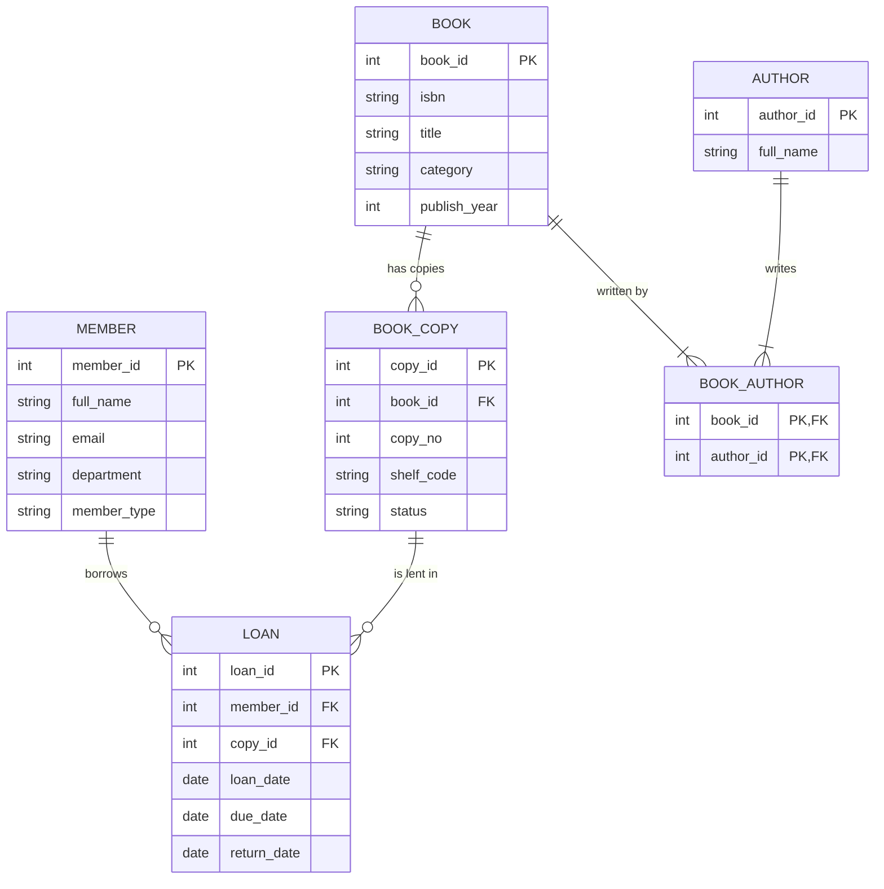

# ER diyagramı: Kampüs Kütüphanesi

## Kardinaliteler

- Bir üye sıfır ya da çok ödünç alır; her ödünç tek bir üyeye aittir.
- Bir nüsha zaman içinde sıfır ya da çok kez ödünç verilir; her ödünç tek bir nüshaya aittir.
- Bir kitabın sıfır ya da çok nüshası olabilir (yeni sipariş edilen kitabın henüz nüshası yoktur); her nüsha tek bir kitaba aittir.
- Kitap ile yazar arasında M:N ilişki vardır ve `BOOK_AUTHOR` ara tablosuyla kurulur.
